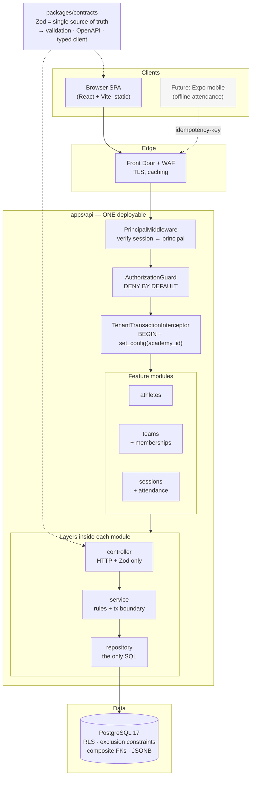
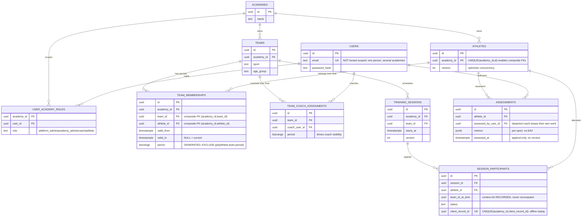
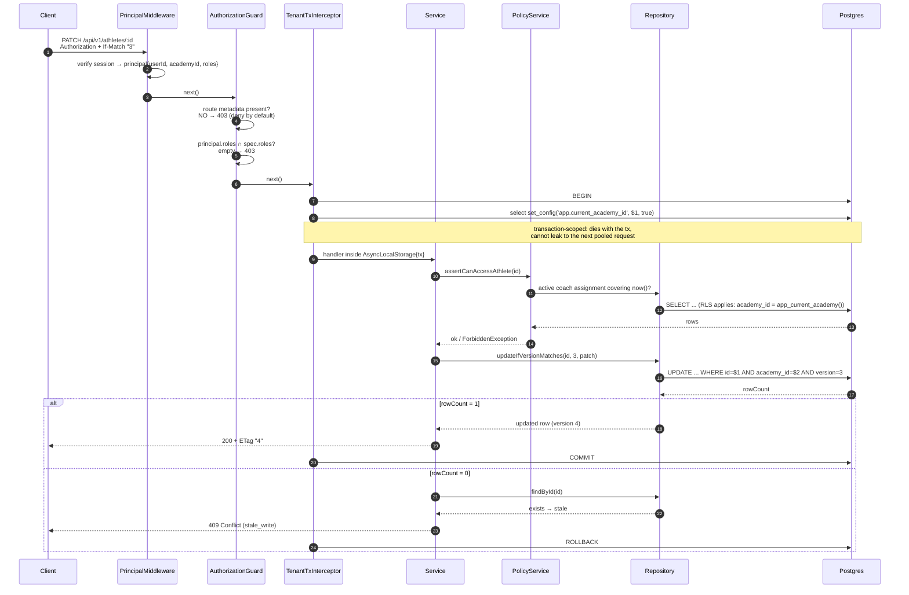
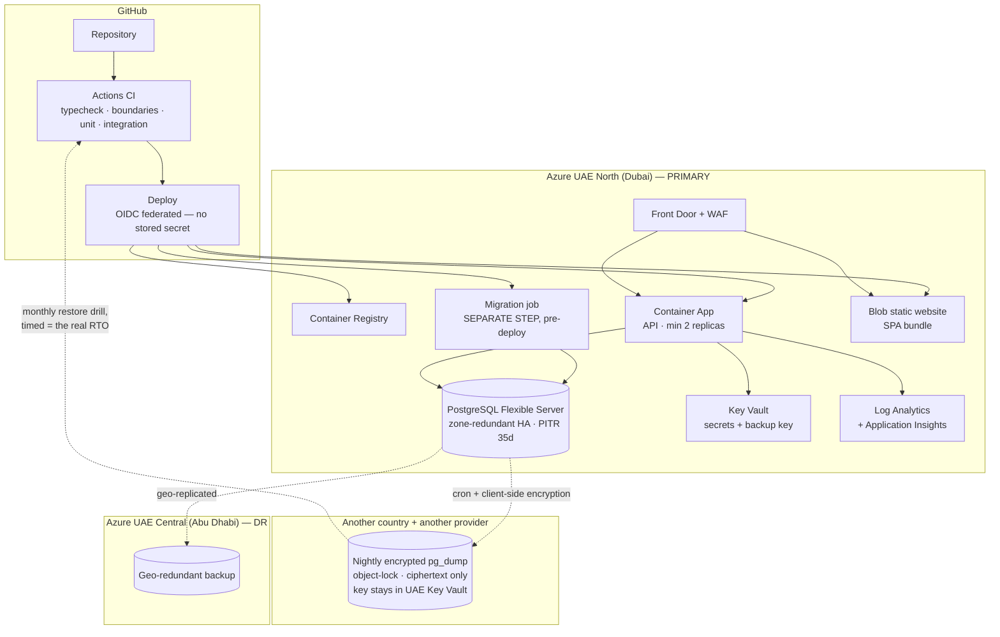

# Athlete & Coach Management Platform — Technical Proposal

Technical case study: architecture, technology selection, backend design and production
deployment for a multi-academy athlete and coach management platform.

> **How to read this repository.** The written proposal is in [`docs/`](./docs). The code
> is not a product — it is **evidence**. One vertical slice carries every hard claim the
> proposal makes, and the hard claims are asserted by tests you can run. What is
> deliberately *not* built is listed at the bottom, with reasons.

---

## The five most important technical decisions

| # | Decision | Alternatives considered | Trade-off accepted |
|---|---|---|---|
| **1** | **Modular monolith**: one NestJS deployable, feature modules with controller → service → repository layers, boundaries enforced by `dependency-cruiser` in CI | Microservices; vertical slices; hexagonal; full DDD with aggregates | No independent scaling or independent deploys per module. At ~2,000 peak concurrent users that buys nothing, and the module boundaries remain extraction seams if it ever does. Accepting a lint rule as the boundary guard instead of a network boundary. |
| **2** | **Postgres RLS as the tenant boundary**, set per request via transaction-scoped `set_config`, with composite foreign keys carrying `academy_id`, and app-layer scoping as defence in depth | Schema-per-tenant; database-per-tenant; application-only scoping | Every request runs inside a transaction, and the app must connect as a non-owner `NOBYPASSRLS` role. In exchange, a forgotten tenant predicate returns **zero** rows instead of another academy's data, and a cross-tenant *reference* is rejected by the database. |
| **3** | **Temporal membership**: team membership is a `tstzrange` period with a GiST exclusion constraint; attendance is recorded as **participation facts** carrying the team context at that moment | Mutable `team_id` on the athlete; audit-log/event-sourced history; SQL Server temporal tables | Writes are slightly more involved (close a period, open a period) and every "current team" query is a point-in-time containment test. In exchange, transferring an athlete cannot rewrite last month's attendance register — the defect this design exists to make impossible. |
| **4** | **Drizzle with hand-written SQL migrations**, forward-only expand/contract, run as a separate CI job before deploy | Prisma; TypeORM; Kysely; ORM-generated migrations | More SQL written by hand, and no generated down migrations. Necessary, not stylistic: RLS policies, `FORCE ROW LEVEL SECURITY`, GiST exclusion constraints, generated range columns and `SECURITY DEFINER` functions cannot be expressed in a schema DSL — and they are exactly where the guarantees live. |
| **5** | **Azure UAE North primary + UAE Central DR**, containers plus managed Postgres, deliberately portable | AWS `me-central-1`; GCP; AWS outside the UAE; sovereign/local providers | Not a product preference — a region-availability decision. AWS `me-central-1` has been impaired since 1 March 2026 with permanent data loss in one AZ, and GCP has no UAE region, so Azure is the only provider currently offering in-country primary **and** in-country DR. Accepting a less familiar managed-container product to keep residency and DR in-country. |

**The position underneath decision 5, which reframes the whole reliability section:**
in-country hosting is a *residency* requirement, not a *resilience* strategy. Multi-AZ
protects against a rack, power or cooling failure. It does not protect against a
regional kinetic event — in March 2026 two of three AWS UAE availability zones went
down together. The control for that is encrypted backups held out of country and out of
provider, with a restore that has actually been performed and timed.

---

## Architecture



**Why it stays maintainable as it grows:** the layers are enforced, not documented.
`pnpm lint:boundaries` fails the build when a controller imports a repository, when one
feature module reaches into a sibling's internals, or when anything outside a repository
imports the database schema. Every legitimate exception to that last rule is written
down in [`.dependency-cruiser.cjs`](./.dependency-cruiser.cjs) with its justification.

**Its limitations, stated rather than discovered in review:** one deployable means one
blast radius — a memory leak in reporting degrades attendance recording too. There is no
per-module scaling. A long-running request occupies a database transaction for its whole
life. All three are acceptable at this size and all three have named exit routes in
[`docs/04-scalability-reliability.md`](./docs/04-scalability-reliability.md).

---

## Data model



Three properties to look for, all enforced below the application:

1. `UNIQUE (academy_id, id)` on every parent, so children declare **composite** foreign
   keys. RLS prevents *reading* another academy's rows; this prevents *referencing* them.
2. `EXCLUDE USING gist (athlete_id =, team_id =, period &&)` — scoped deliberately to
   the **same team**, because an athlete may legitimately be in a U17 squad and the first
   team at once. A blanket "one team at a time" constraint would look stricter and be wrong.
3. `ON DELETE RESTRICT` on recorded facts. A register that can be emptied by deleting a
   parent row is not a historical record.

---

## Request path — where tenancy and authorization actually happen



---

## Deployment



Costs, RPO/RTO per failure scenario, and the answers to "budget cut 40%", "single
server" and "50,000 athletes" are in
[`docs/05-deployment.md`](./docs/05-deployment.md).

---

## Running it

```bash
pnpm install
pnpm --filter @athlete/config --filter @athlete/contracts run build

pnpm run typecheck          # TypeScript across the workspace
pnpm run lint               # type-aware ESLint; a dropped `await` is a build failure
pnpm run lint:boundaries    # architecture fitness rules
pnpm --filter @athlete/api run test              # unit — no Docker needed
pnpm --filter @athlete/api run test:integration  # real Postgres via Testcontainers
```

The unit suite needs placeholder env values (`DATABASE_URL`, `SESSION_SECRET`) because
configuration is validated at boot and the app refuses to start half-configured. See
[`.env.example`](./.env.example).

### Run the whole stack — and the single-server answer

`docker compose` is not only for local development: it **is** the answer to the brief's
*"the application must initially run on a single server"* scenario. Same image, Postgres
beside it, one box.

```bash
docker compose up -d --build        # postgres + api
docker compose run --rm migrate     # migrations as a SEPARATE step, as in CI
./scripts/smoke.sh                  # end-to-end checks over HTTP

# if port 5432 or 3000 is already taken on your machine:
POSTGRES_PORT=55432 API_PORT=3100 docker compose up -d --build
POSTGRES_PORT=55432 docker compose run --rm migrate
API_PORT=3100 ./scripts/smoke.sh
```

### Verified state of this repository

Run on macOS, Node 24.14.1, pnpm 11.21.0, Docker 28.3.2, `postgres:17-alpine`:

```
pnpm run typecheck                          ✓ no errors (5 tasks)
pnpm run lint                               ✓ no errors (6 tasks, type-aware)
pnpm run lint:boundaries                    ✓ no violations (56 modules, 112 dependencies)
pnpm run build                              ✓ 3 tasks
test (unit)                                 ✓ 129 passed (8 files)
test:integration (real Postgres)            ✓ 26 passed  (5 files)
docker build -f apps/api/Dockerfile         ✓ image builds
docker compose up + run migrate             ✓ Applied: 0000_init.sql, 0001_rls.sql
./scripts/smoke.sh (containerised stack)    ✓ 16/16 checks passed
```

The smoke run, verbatim — note check 4, which is the same request as check 3 with a
different academy's token:

```
Liveness and deny-by-default
  PASS  health is public                             200
  PASS  no token is refused                          401
Tenant isolation over HTTP (identical request, different academy)
  PASS  academy A sees its athletes                  200
  PASS  academy B sees an empty list                 []
  PASS  A's athlete is invisible to B                404
Optimistic concurrency
  PASS  read returns an ETag                         integer
  PASS  write with current ETag wins                 200
  PASS  stale write is refused                       409
  PASS  write without If-Match refused               400
Error contract (one shape for every failure, not just a status code)
  PASS  conflict is typed CONFLICT                   CONFLICT
  PASS  conflict carries a stable code               stale_write
  PASS  a refusal is typed NOT_FOUND                 NOT_FOUND
  PASS  no token is typed UNAUTHORIZED               UNAUTHORIZED
Validation
  PASS  malformed body is refused                    400
  PASS  malformed id is refused                      400
  PASS  validation is typed BAD_REQUEST              BAD_REQUEST
```

Every failure has the same shape, because a client should be able to write one error
handler. The 409 body, which also has to tell the caller how to recover:

```json
{
  "statusCode": 409,
  "name": "ApiError",
  "message": "Athlete was modified by someone else since you loaded it",
  "type": "CONFLICT",
  "code": "stale_write",
  "explanation": "Re-read the resource and reapply your change. A conflict here means the write was refused, not partially applied.",
  "meta": { "expectedVersion": 0 }
}
```

`type` is the stable category to switch on, `code` identifies the specific failure,
`meta` is machine-readable and `explanation` is for a human. What is **not** in any
body is the `cause` chain: an unexpected failure is redacted to `"Internal server
error"` and the original survives only in the log. Provoking one deliberately — an
unparseable `?at` reaching the driver — the client gets:

```json
{ "statusCode": 500, "name": "ApiError", "message": "Internal server error", "type": "INTERNAL" }
```

while the log line carries the full failing SQL, its bound parameters and the tenant
id. That asymmetry is the point of keeping `cause` unserialisable: a filter can attach
a raw `pg` error without anyone having to judge whether it leaks.

**Terraform has not been applied or validated** — no Azure subscription and no
Terraform binary were available. It is a reviewed design artifact; expect
provider-schema corrections on first `plan`. [`infra/terraform/README.md`](./infra/terraform/README.md)
lists exactly what is stubbed.

---

## The tests are the argument

Each one exists to make a specific claim falsifiable.

| Test | Claim it proves | Brief's requirement / scenario |
|---|---|---|
| `tenancy.isolation.integration` | Connects as a **`NOBYPASSRLS` non-owner role**, then: an academy sees only its own athletes; no tenant context returns **zero** rows (fails closed); inserting into another academy is refused; **referencing** another academy's team is refused by a composite FK; cross-tenant role lookup exists only behind one audited `SECURITY DEFINER` function | "prevent unauthorized access between academies" |
| `temporal.membership.integration` | Overlapping periods in the same team rejected; concurrent membership of *different* teams allowed; back-to-back periods permitted (`[)` bounds); inverted periods rejected; "who was on this team in March" answered from the period | "maintaining historical records" |
| `history.transfer.integration` | Record attendance → transfer the athlete → **February's register and roster are unchanged**; an athlete with history cannot be deleted; a replayed offline submission inserts nothing | "maintaining historical records when athletes change teams" |
| `concurrency.optimistic-lock.integration` | Two writers hold version 0; the first wins, the second affects **zero rows** → 409, and the first writer's change survives; no row lock is held across user think-time | "two users update the same record simultaneously" |
| `authz.route-coverage` | Walks the real module graph and fails if **any** route lacks `@Permission` or `@Public`; every declared `(action, subject)` is in the shared vocabulary and every subject is claimed by a route or explicitly reserved; the public allowlist is asserted explicitly; the committed [route manifest](docs/reference/route-manifest.md), with paths as served under `/api/v1`, must match the code | "secure access based on user roles and responsibilities" |
| `authz.ability.unit` | One CASL ability definition is the whole policy: grants per role; the operations each route demanded before are held by exactly the roles those routes listed; the coarse (guard) and scoped (query) modes agree on which operations exist, and scoped never grants what the guard refuses; a coach with no active assignment gets **no rule**, not a rule over an empty list | "secure access based on user roles and responsibilities" |
| `authz.guard.unit` | The guard refuses an undeclared route even for a platform administrator, answers 401 without a principal, and decides from the ability rather than a role list on the route | "secure access based on user roles and responsibilities" |
| `authz.to-sql-where.unit` | A rule condition compiles to the SQL it says (asserted on rendered text and bound parameters), agrees with the in-memory matcher on `NULL` — including ordering, where CASL coerces null to 0, cross-checked against the real matcher — and **throws** on an unknown operator, an unmapped field, a relation or a boolean ordering operand — a restriction is never silently dropped | — |
| `authz.accessible-by.unit` | The query filter derived from an ability is unrestricted for an administrator, a predicate for a coach, and a **403** when nothing grants the action — never an unfiltered query | — |
| `authz.principal-scope.integration` | A coach's scope follows the periods in the data at one instant: a closed assignment contributes no team, an athlete who left drops out, the period is half-open, the instant is the database transaction's `now()` rather than the host clock, and the same user's assignment in another academy is unreachable | "secure access based on user roles and responsibilities" |
| `optimistic-concurrency.unit` | `If-Match`/`ETag` parsing, including malformed and weak validators; a stale write is a 409 carrying the version the caller held | "two users update the same record simultaneously" |
| `api-error.unit` | Every error type maps to the status and log severity the contract promises, the type list is exhaustive (adding one without a status fails here), and `toJSON` cannot serialise `cause` | — |
| `error-responder.unit` | One log line per failure at its own severity; `meta` logged for 5xx and withheld for 4xx; an unexpected error is redacted to `"Internal server error"` while the **whole cause chain** reaches the log, bounded and cycle-guarded; a 5xx `HttpException` is redacted the same way, payload and all, so choosing a status is not a claim the message is publishable; an `http-errors` 4xx keeps its status only when it marked itself exposable; a response already begun is closed rather than crashed | — |

### Three findings from actually running this

The first version of the isolation suite **passed while reading across tenants.**

`ALTER TABLE ... FORCE ROW LEVEL SECURITY` subjects the table *owner* to its policies,
but a **superuser — or any role with `BYPASSRLS` — ignores row-level security entirely**,
and `FORCE` does not change that. The tests were connecting as the container's default
superuser, so the policies were inert and the assertions were meaningless.

The suite now connects as `athlete_app`, the same non-owner `NOBYPASSRLS` role the
application uses in production, and
[asserts that premise first](./apps/api/test/tenancy.isolation.integration.spec.ts)
(`rolsuper = false`, `rolbypassrls = false`) before asserting anything else. An RLS test
suite that does not verify which role it is running as is decoration.

**2. A middleware on the Express 5 path `'*'` silently never runs.**

Nest 11 runs on Express 5 / path-to-regexp v8, where a bare `'*'` matches nothing.
Authentication was registered as middleware `.forRoutes('*')`, so no principal was ever
attached and **every authenticated request returned 401** — with no error logged
anywhere. The integration suite stayed green throughout, because it asserts database
guarantees directly and never traverses the HTTP stack.

Authentication is now a global guard instead: no path pattern to get wrong, and global
guards still run before interceptors, so the tenant transaction can read the principal.

**3. Zod 4's `z.uuid()` is stricter than Postgres's `uuid` type.**

`z.uuid()` enforces RFC 9562 version and variant bits, so it rejects identifiers that
Postgres stores quite happily. An API that validates more strictly than its own database
can refuse to return a row it is holding. The shared `Uuid` primitive is now `z.guid()`,
and path parameters validate against that same primitive rather than Nest's
`ParseUUIDPipe` — so there is exactly one definition of a valid id, which was the point
of `packages/contracts` in the first place.

**Why this matters beyond the bugs:** findings 2 and 3 were invisible to 17 passing
integration tests and caught by the smoke script in under a minute. Database
tests and wiring tests catch different classes of defect. Keeping both is cheap; relying
on either alone is how an API that returns 401 to everyone passes CI.

---

## Deliberately not built

Scope choices, each one a decision rather than an omission:

- **Web UI beyond the deployment shape.** The brief states frontend design is not being
  assessed. `apps/web` holds the build target and the reasoning only.
- **Native mobile.** Out of scope — but the real-world gap is named: coaches mark
  attendance pitch-side on poor connectivity. The write API is therefore already
  idempotent (client-generated UUIDs + `Idempotency-Key`), so offline sync becomes a
  feature rather than a rewrite. Proven by the replay test.
- **Full CRUD across all entities.** Coaches, assessments and scheduling exist in the
  schema and the proposal, not in the API surface. Six shallow modules would prove less
  than one slice that carries every hard guarantee.
- **Credential storage and session management.** Production uses a maintained auth
  library (argon2id, refresh rotation, TOTP) with users and sessions in this same
  Postgres. The slice implements token *verification* so the authorization and tenancy
  paths are exercised with a real principal. Hand-rolling credential storage to pad a
  case study would be the wrong signal.
- **OpenAPI generation and the generated client.** Specified in
  [`docs/01-technology-stack.md`](./docs/01-technology-stack.md); the Zod contracts it
  generates from are already the single source of truth in `packages/contracts`.
- **Front Door, private networking, backup cron, restore drill.** Marked `STUB` in the
  Terraform file each belongs in.

## Assumptions made where the brief was silent

| Assumption | Why it matters |
|---|---|
| **15–30 academies initially, ~200 at the 10× ceiling** | The brief gives athletes and coaches but never the tenant count — and that number is what decides shared-schema vs schema-per-tenant. At 20 tenants schema-per-tenant is viable; at 200 it is an operations problem. |
| **An athlete may hold concurrent memberships in different teams** | Determines the exclusion constraint's scope. Raised as an open requirements question rather than assumed away; the permissive floor is implemented. |
| **RPO 15 min / RTO 4 h for regional failure** | No targets were given. Deliberately modest: attendance recording is not life-critical, so coaches use paper for two hours and sync later. Over-engineering to RPO-zero would be the mistake. |
| **Athletes are frequently minors; performance data is health-adjacent** | Makes UAE PDPL, consent and audit real considerations rather than boilerplate. |
| **No third-party integrations required at launch** | Justifies REST + OpenAPI as sufficient and GraphQL as unnecessary. |

## Repository layout

```
apps/
  api/                  NestJS — the one deployable
    drizzle/            hand-written SQL migrations (schema, then RLS)
    src/common/         tenancy, authz, errors, HTTP concerns
    src/modules/        athletes · teams · sessions · auth
    test/               unit + Testcontainers integration
  web/                  SPA build target (deliberately minimal)
packages/
  contracts/            Zod schemas — single source of truth
  config/               fail-fast env validation
tooling/
  eslint-config/        the type-aware lint gate, and why it is one
infra/terraform/        Azure UAE North / UAE Central
docs/                   the written proposal (A–E of the brief)
scripts/                smoke check, demo seed, dev token minting
apps/api/Dockerfile     multi-stage, non-root, prod deps only
docker-compose.yml      local dev AND the single-server deployment answer
.dependency-cruiser.cjs architecture fitness rules
lefthook.yml            pre-commit: the same lint and typecheck gates CI runs
```
