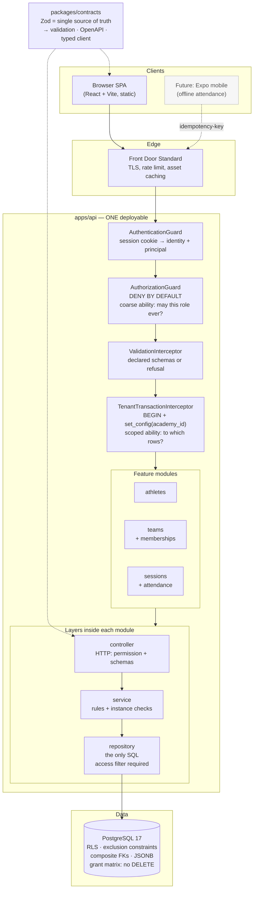
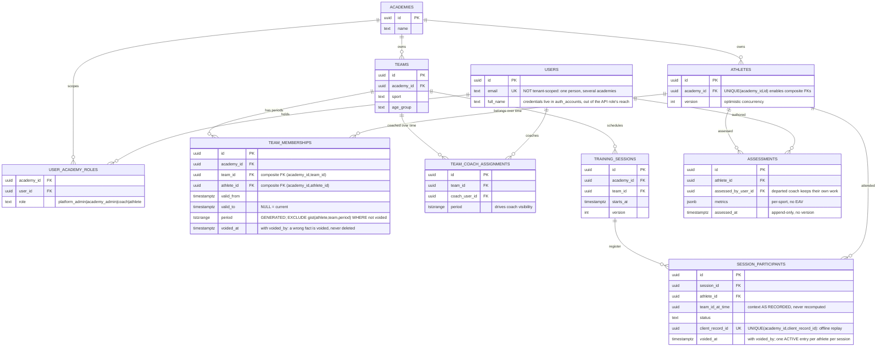
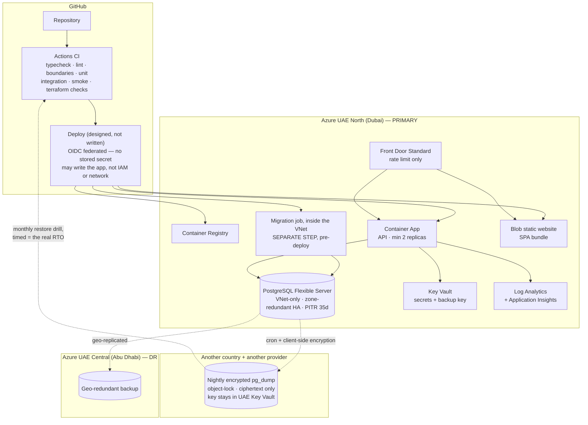

# Athlete & Coach Management Platform — Technical Proposal

Technical case study: architecture, technology selection, backend design and production
deployment for a multi-academy athlete and coach management platform.

> **How to read this repository.** The written proposal is in [`docs/`](./docs). The code
> is not a product — it is **evidence**. One vertical slice carries every hard claim the
> proposal makes, and the hard claims are asserted by tests you can run. What is
> deliberately *not* built is listed at the bottom, with reasons.

---

## The five most important technical decisions

| # | Decision | Alternatives considered | Trade-off accepted |
|---|---|---|---|
| **1** | **Modular monolith**: one NestJS deployable, feature modules with controller → service → repository layers, boundaries enforced by `dependency-cruiser` in CI | Microservices; vertical slices; hexagonal; full DDD with aggregates | No independent scaling or independent deploys per module. At ~2,000 peak concurrent users that buys nothing, and the module boundaries remain extraction seams if it ever does. Accepting a lint rule as the boundary guard instead of a network boundary. |
| **2** | **Postgres RLS as the tenant boundary**, set per request via transaction-scoped `set_config`, with composite foreign keys carrying `academy_id`, and app-layer scoping as defence in depth | Schema-per-tenant; database-per-tenant; application-only scoping | Every request runs inside a transaction, and the app must connect as a non-owner `NOBYPASSRLS` role. In exchange, a forgotten tenant predicate returns **zero** rows instead of another academy's data, and a cross-tenant *reference* is rejected by the database. |
| **3** | **Temporal membership**: team membership is a `tstzrange` period with a GiST exclusion constraint; attendance is recorded as **participation facts** carrying the team context at that moment | Mutable `team_id` on the athlete; audit-log/event-sourced history; SQL Server temporal tables | Writes are slightly more involved (close a period, open a period) and every "current team" query is a point-in-time containment test. In exchange, transferring an athlete cannot rewrite last month's attendance register — the defect this design exists to make impossible. |
| **4** | **Drizzle with hand-written SQL migrations**, forward-only expand/contract, run as a separate CI job before deploy | Prisma; TypeORM; Kysely; ORM-generated migrations | More SQL written by hand, and no generated down migrations. Necessary, not stylistic: RLS policies, `FORCE ROW LEVEL SECURITY`, GiST exclusion constraints, generated range columns and `SECURITY DEFINER` functions cannot be expressed in a schema DSL — and they are exactly where the guarantees live. |
| **5** | **Azure UAE North primary + UAE Central DR**, containers plus managed Postgres, deliberately portable | AWS `me-central-1`; GCP; AWS outside the UAE; sovereign/local providers | Not a product preference — a region-availability decision. AWS `me-central-1` has been impaired since 1 March 2026 with permanent data loss in one AZ, and GCP has no UAE region, so Azure is the only provider currently offering in-country primary **and** in-country DR. Accepting a less familiar managed-container product to keep residency and DR in-country. |

**The position underneath decision 5, which reframes the whole reliability section:**
in-country hosting is a *residency* requirement, not a *resilience* strategy. Multi-AZ
protects against a rack, power or cooling failure. It does not protect against a
regional kinetic event — in March 2026 two of three AWS UAE availability zones went
down together. The control for that is encrypted backups held out of country and out of
provider, with a restore that has actually been performed and timed.

The next tier of decisions is in
[`docs/06-decision-summary.md`](./docs/06-decision-summary.md), including one that was
**reversed** with the reason recorded (authorization: CASL was first rejected, then
adopted). The decisions made while hardening the slice each have a record in
[`docs/adr/`](./docs/adr/README.md).

---

## Architecture



**Why it stays maintainable as it grows:** the layers are enforced, not documented.
`pnpm lint:boundaries` fails the build when a controller imports a repository, when one
feature module reaches into a sibling's internals, or when anything outside a repository
imports the database schema. Every legitimate exception to that last rule is written
down in [`.dependency-cruiser.cjs`](./.dependency-cruiser.cjs) with its justification.
Authorization is enforced the same way rather than remembered: one
[CASL](https://casl.js.org) ability definition is the whole policy, a route with no
declared permission is refused, and a repository read does not compile without the row
filter derived from that policy
([`docs/02-architecture.md`](./docs/02-architecture.md#authorization-one-policy-asked-two-ways)).

**Its limitations, stated rather than discovered in review:** one deployable means one
blast radius — a memory leak in reporting degrades attendance recording too. There is no
per-module scaling. A long-running request occupies a database transaction for its whole
life. All three are acceptable at this size and all three have named exit routes in
[`docs/04-scalability-reliability.md`](./docs/04-scalability-reliability.md).

---

## Data model



Four properties to look for, all enforced below the application:

1. `UNIQUE (academy_id, id)` on every parent, so children declare **composite** foreign
   keys. RLS prevents *reading* another academy's rows; this prevents *referencing* them.
2. `EXCLUDE USING gist (athlete_id =, team_id =, period &&)` — scoped deliberately to
   the **same team**, because an athlete may legitimately be in a U17 squad and the first
   team at once. A blanket "one team at a time" constraint would look stricter and be wrong.
3. `ON DELETE RESTRICT` on recorded facts. A register that can be emptied by deleting a
   parent row is not a historical record. (Until `0002_grants.sql` this was claimed and
   not true: `training_sessions` and `teams` cascaded onto the register and the
   membership history. `academy_id → academies` still cascades, deliberately — removing a
   tenant removes the tenant.)
4. A privilege matrix, not one role with full DML. `athlete_app` has **no `DELETE` on
   anything**, column-level `UPDATE` on recorded facts (the voiding columns only — a
   wrong fact is voided and replaced, never edited), `SELECT` only on academies and
   role grants, nothing at all on `users` (it holds credentials and has no tenant
   policy), and nothing on a future table until a migration grants it. A trigger makes
   `valid_to` and the voiding columns final once set, so a closed period cannot be
   reopened and a void cannot be undone by that role. The API checks at boot that it is
   connected as that role, holding no more than this matrix, and refuses to start
   otherwise.

---

## Request path — where tenancy and authorization actually happen

```mermaid
sequenceDiagram
    autonumber
    participant C as Client
    participant A as AuthenticationGuard
    participant G as AuthorizationGuard
    participant V as ValidationInterceptor
    participant I as TenantTxInterceptor
    participant S as Service
    participant R as Repository
    participant DB as Postgres

    C->>A: PATCH /api/v1/athletes/:id<br/>session cookie + If-Match "3"
    A->>A: session row → identity; roles read now → principal{userId, academyId, roles}<br/>attaches or not, never refuses
    A->>G: next()
    G->>G: exactly one of @Permission, @Authenticated, @Public declared?<br/>NO → 403 (deny by default)
    G->>G: COARSE ability: can(update, athletes)?<br/>no conditions, no database · NO → 403
    G->>V: next()
    V->>V: parse params + body with the route's declared schemas<br/>unknown or empty → 400, no transaction opened
    V->>I: next()
    I->>DB: BEGIN
    I->>DB: select set_config('app.current_academy_id', $1, true), now()
    Note over I,DB: transaction-scoped: dies with the tx,<br/>cannot leak to the next pooled request
    I->>DB: coach only: active assignments, then active memberships, as of now()
    DB-->>I: activeTeamIds, visibleAthleteIds (RLS applies)
    I->>I: SCOPED ability: same rules, now with conditions
    I->>S: handler inside AsyncLocalStorage{tx, ability}
    S->>S: assertCan(update, athletes, {id})<br/>in memory, synchronous · out of scope → 403
    S->>R: updateIfVersionMatches(id, 3, patch, accessFilter)
    R->>DB: UPDATE ... WHERE id=$1 AND academy_id=$2 AND version=3<br/>AND id IN (visibleAthleteIds)
    DB-->>R: rowCount
    alt rowCount = 1
        R-->>S: updated row (version 4)
        S-->>C: 200 + ETag "4"
        I->>DB: COMMIT
    else rowCount = 0
        S->>R: findById(id, accessFilter)
        R-->>S: exists → stale
        S-->>C: 409 Conflict (stale_write)
        I->>DB: ROLLBACK
    end
```

The same policy is asked twice, and that is the design: once before any query, without
conditions, to decide whether the route is open to this role at all; once inside the
tenant transaction, with the principal's teams and athletes resolved, to decide which
rows. An administrator's access filter is empty (RLS is their only boundary), so the
`AND id IN (...)` line exists only for a coach.

---

## Deployment



Costs, RPO/RTO per failure scenario, and the answers to "budget cut 40%", "single
server" and "50,000 athletes" are in
[`docs/05-deployment.md`](./docs/05-deployment.md). Two labels in this diagram are
deliberately modest: the edge is Front Door **Standard**, whose WAF is a single
rate-limit rule and whose origins are also reachable directly; and the deploy pipeline
is a designed sequence, not a written workflow. None of this infrastructure has been
applied.

---

## Running it

```bash
pnpm install
pnpm --filter @athlete/config --filter @athlete/contracts run build

pnpm run typecheck          # TypeScript across the workspace
pnpm run lint               # type-aware ESLint; a dropped `await` is a build failure
pnpm run lint:boundaries    # architecture fitness rules
pnpm --filter @athlete/api run test              # unit — no Docker needed
pnpm --filter @athlete/api run test:integration  # real Postgres via Testcontainers
```

Neither suite needs any environment: the unit suite never boots the application, and
the integration suite builds its own connection strings from the containers it starts.

### Run the API on the host

```bash
pnpm dev        # dotenvx run --strict -f .env.development -- start:dev
```

[`.env.development`](./.env.development) is committed with its secret values
encrypted by [dotenvx](https://dotenvx.com); the private key is `.env.keys`, which is
git-ignored and travels out of band. Without it the command stops with
`DECRYPTION_FAILED` naming the variables, rather than booting on ciphertext. **A
reviewer without the key is not blocked**: the compose stack below needs no env file at
all, and [`.env.example`](./.env.example) lists the same variables in the clear for
exporting by hand. A variable already set in the shell wins over the file
(`DATABASE_URL=... pnpm dev`).

### Run the whole stack — and the single-server answer

`docker compose` is not only for local development: it **is** the answer to the brief's
*"the application must initially run on a single server"* scenario. Same image, Postgres
beside it, one box.

```bash
docker compose up -d --build        # postgres + api
docker compose run --rm migrate     # migrations as a SEPARATE step, as in CI
./scripts/smoke.sh                  # end-to-end checks over HTTP (seeds what it needs)

# if port 5432 or 3000 is already taken on your machine:
POSTGRES_PORT=55432 API_PORT=3100 docker compose up -d --build
POSTGRES_PORT=55432 docker compose run --rm migrate
API_PORT=3100 ./scripts/smoke.sh
```

### Sign in

There is no sign-up: an account is created by an operator, with the owner connection,
the same way a migration is run. [`scripts/seed-dev.sh`](./scripts/seed-dev.sh) does
that for a local stack — the demo academies, teams and athletes, plus an administrator
and a coach of Alpha Academy:

```bash
./scripts/seed-dev.sh               # admin@alpha.test, coach@alpha.test
                                    # password: $SEED_PASSWORD, default athlete-dev-password

# sign in: the session comes back as an httpOnly cookie
curl -c jar -H 'Content-Type: application/json' -H 'Origin: http://localhost:3000' \
  -d '{"email":"coach@alpha.test","password":"athlete-dev-password"}' \
  http://localhost:3000/api/auth/sign-in/email

curl -b jar http://localhost:3000/api/v1/me         # who am I, where, and what may I attempt
curl -b jar http://localhost:3000/api/v1/athletes   # the coach's own team, and only that

# any other account: the operator CLI, password on stdin
printf '%s' 'a-long-password' | docker compose run --rm -T migrate \
  node dist/cli/create-user.js --email new@alpha.test --name 'New Person' \
  --academy 11111111-1111-1111-1111-111111111111 --role coach
```

Sign-in, sign-out and change-password are better-auth's own routes under `/api/auth`;
everything else is under `/api/v1`. Why sessions are rows, why better-auth has a
database role of its own, and why the browser cannot choose its academy:
[ADR 0006](./docs/adr/0006-cookie-sessions-and-the-auth-role.md).

### Verified state of this repository

Run on 22 November 2026, in this order, on macOS, Node 24.14.1, pnpm 11.21.0, Docker
28.3.2, `postgres:17-alpine`. Turborepo's cache was bypassed (`--force`) and the compose
stack was started on a fresh volume:

```
pnpm install --frozen-lockfile              ✓ lockfile unchanged
pnpm run typecheck                          ✓ no errors (5 tasks)
pnpm run lint                               ✓ no errors (6 tasks, type-aware)
pnpm run lint:boundaries                    ✓ no violations (73 modules, 163 dependencies)
pnpm run build                              ✓ 3 tasks
test (unit + route coverage + HTTP)         ✓ 235 passed (14 files)
test:integration (real Postgres)            ✓ 107 passed (9 files)
docker build -f apps/api/Dockerfile         ✓ image builds
docker compose up + run migrate             ✓ Applied: 0000_init.sql, 0001_rls.sql, 0002_grants.sql, 0003_auth.sql
./scripts/smoke.sh (containerised stack)    ✓ 64/64 checks passed
```

The smoke run, verbatim, from that fresh volume. Every request after the first block
carries a session cookie obtained by signing in over HTTP; "academy B sees an empty
list" is the same request as the line above it with another person's cookie:

```
Signing in (a session row behind an httpOnly cookie)
  PASS  wrong password is refused                    401
  PASS  Alpha's administrator signs in               200
  PASS  Beta's administrator signs in                200
  PASS  the coach signs in                           200
  PASS  the cookie is httpOnly                       1
  PASS  a burst of sign-ins is rate limited          429
  PASS  public sign-up is closed                     false

Liveness and deny-by-default
  PASS  health is public                             200
  PASS  no cookie is refused                         401
  PASS  a made-up cookie is refused                  401

Tenant isolation over HTTP (identical request, different academy)
  PASS  academy A sees its athletes                  200
  PASS  academy B sees an empty list                 []
  PASS  A's athlete is invisible to B                404

Resource scoping inside one academy (a coach of team A; team B exists beside it)
  PASS  coach lists only their team's athletes       44444444-4444-4444-4444-444444444444
  PASS  coach is refused team B's roster             403

Optimistic concurrency
  PASS  read returns an ETag                         integer
  PASS  write with current ETag wins                 200
  PASS  stale write is refused                       409
  PASS  write without If-Match refused               400

Error contract (one shape for every failure, not just a status code)
  PASS  conflict is typed CONFLICT                   CONFLICT
  PASS  conflict carries a stable code               stale_write
  PASS  a refusal is typed NOT_FOUND                 NOT_FOUND
  PASS  no cookie is typed UNAUTHORIZED              UNAUTHORIZED

Validation (on by default; a 200 never means "nothing happened")
  PASS  malformed body is refused                    400
  PASS  malformed id is refused                      400
  PASS  validation is typed VALIDATION               VALIDATION
  PASS  the failing field is named                   params:id
  PASS  misspelled field is refused                  400
  PASS  ...and names the field                       body:dateofBirth
  PASS  empty patch is refused                       400
  PASS  the ETag did not move                        1 integer
  PASS  garbage query value is a 400                 400
  PASS  a valid instant is accepted                  200
  PASS  unknown query parameter refused              400

Who am I (GET /me: academies, and the coarse permissions of the active one)
  PASS  /me needs a session                          401
  PASS  /me names the signed-in user                 admin@alpha.test
  PASS  ...their academies and roles                 Alpha Academy:academy_admin
  PASS  ...and the active academy                    11111111-1111-1111-1111-111111111111
  PASS  an admin may create athletes                 true
  PASS  a coach may not                              false
  PASS  a coach may record attendance                true
  PASS  the wildcard is never reported               false

Switching academy (the server chooses; the browser asks)
  PASS  member of both signs in                      200
  PASS  starts in the first academy by name          11111111-1111-1111-1111-111111111111
  PASS  ...as a coach there                          false
  PASS  switches to the other academy                200
  PASS  the session moved                            22222222-2222-2222-2222-222222222222
  PASS  ...with the roles held THERE                 true
  PASS  ...and sees that academy's data              []
  PASS  an academy that is not theirs is 403         403
  PASS  ...typed not_a_member                        not_a_member
  PASS  ...and the session did not move              11111111-1111-1111-1111-111111111111
  PASS  update-session cannot choose a tenant        11111111-1111-1111-1111-111111111111

Origin check (a cookie is ambient; a state-changing request must say where it is from)
  PASS  POST from a foreign origin is 403            403
  PASS  ...typed invalid_origin                      invalid_origin
  PASS  ...and nothing was written                   0
  PASS  a foreign-origin GET is not refused          200
  PASS  the application's own origin passes          200
  PASS  better-auth refuses it on its routes         403
  PASS  ...and the session survived that             200

Signing out (the row is deleted, so a copied cookie is worth nothing)
  PASS  sign-out succeeds                            200
  PASS  the old cookie is refused                    401
  PASS  ...on every route                            401
  PASS  another session is unaffected                200

All smoke checks passed.
```

The script is re-runnable: a second run against the same volume also passes 64/64, with
a higher integer on the ETag line. It takes about half a minute, most of it spent
waiting out the sign-in rate limit it then asserts.

Every failure has the same shape, because a client should be able to write one error
handler. The 409 body, which also has to tell the caller how to recover:

```json
{
  "statusCode": 409,
  "name": "ApiError",
  "message": "Athlete was modified by someone else since you loaded it",
  "type": "CONFLICT",
  "code": "stale_write",
  "explanation": "Re-read the resource and reapply your change. A conflict here means the write was refused, not partially applied.",
  "meta": { "expectedVersion": 0 }
}
```

`type` is the stable category to switch on, `code` identifies the specific failure,
`meta` is machine-readable and `explanation` is for a human. What is **not** in any
body is the `cause` chain: an unexpected failure is redacted to `"Internal server
error"` and the original survives only in the log. When one was provoked
deliberately — an unparseable `?at` on the roster route, which used to reach the
driver — the client got:

```json
{ "statusCode": 500, "name": "ApiError", "message": "Internal server error", "type": "INTERNAL" }
```

while the log line carries the full failing SQL, its bound parameters and the tenant
id. That asymmetry is the point of keeping `cause` unserialisable: a filter can attach
a raw `pg` error without anyone having to judge whether it leaks.

That particular request no longer gets that far, because it was never a server fault.
Every route declares the schemas its input must satisfy and nothing reaches a handler
unparsed, so the same `?at=garbage` is now the caller's 400, with the field named:

```json
{
  "statusCode": 400,
  "name": "ApiError",
  "message": "Request validation failed",
  "type": "VALIDATION",
  "code": "validation_failed",
  "meta": { "fields": [{ "in": "query", "path": "at", "messages": ["Invalid ISO datetime"] }] }
}
```

The redaction itself stays asserted by `error-responder.unit`.

**Terraform has been validated but never planned or applied** — there is no Azure
subscription. Every stack passes `fmt`, `validate` against the locked azurerm schema,
`terraform test` with a mocked provider, and `tflint` with the azurerm ruleset (CI runs
the same four). None of that touches Azure: the permission lists are reasoned, not
exercised, and regional availability is unchecked.
[`infra/terraform/README.md`](./infra/terraform/README.md) lists what was verified, what
was not, and what is still a stub.

---

## The tests are the argument

Each one exists to make a specific claim falsifiable.

| Test | Claim it proves | Brief's requirement / scenario |
|---|---|---|
| `tenancy.isolation.integration` | Connects as a **`NOBYPASSRLS` non-owner role**, then: an academy sees only its own athletes; no tenant context returns **zero** rows (fails closed); inserting into another academy is refused; **referencing** another academy's team is refused by a composite FK; cross-tenant role lookup exists only behind one audited `SECURITY DEFINER` function | "prevent unauthorized access between academies" |
| `temporal.membership.integration` | Overlapping periods in the same team rejected; concurrent membership of *different* teams allowed; back-to-back periods permitted (`[)` bounds); inverted periods rejected; "who was on this team in March" answered from the period | "maintaining historical records" |
| `history.transfer.integration` | Record attendance → transfer the athlete → **February's register and roster are unchanged**; an athlete with history cannot be deleted — by the application role (no privilege) or by the owner (`RESTRICT`); a replayed offline submission inserts nothing | "maintaining historical records when athletes change teams" |
| `concurrency.optimistic-lock.integration` | Two writers hold version 0; the first wins, the second affects **zero rows** → 409, and the first writer's change survives; no row lock is held across user think-time | "two users update the same record simultaneously" |
| `authz.route-coverage` | Walks the real module graph and fails if **any** route does not carry exactly one of `@Permission`, `@Authenticated` and `@Public`; every declared `(action, subject)` is in the shared vocabulary and every subject is claimed by a route or explicitly reserved; the public allowlist is asserted explicitly; the committed [route manifest](docs/reference/route-manifest.md), with paths as served under `/api/v1`, must match the code. The same walk covers validation: no handler binds `@Body`, `@Param` or `@Query`; every part of the request a handler reads, every body-taking method and every path parameter has a declared schema; and every declared schema refuses an unknown key | "secure access based on user roles and responsibilities" |
| `authz.ability.unit` | One CASL ability definition is the whole policy: grants per role; the operations each route demanded before are held by exactly the roles those routes listed; the coarse (guard) and scoped (query) modes agree on which operations exist, and scoped never grants what the guard refuses; a coach with no active assignment gets **no rule**, not a rule over an empty list | "secure access based on user roles and responsibilities" |
| `authz.guard.unit` | The guard refuses an undeclared route even for a platform administrator, **and one with two declarations**; answers 401 without a session; admits an account with no academy to an `@Authenticated` route and refuses it a `@Permission` one; and decides from the ability rather than a role list on the route | "secure access based on user roles and responsibilities" |
| `authz.to-sql-where.unit` | A rule condition compiles to the SQL it says (asserted on rendered text and bound parameters), agrees with the in-memory matcher on `NULL` — including ordering, where CASL coerces null to 0, cross-checked against the real matcher — and **throws** on an unknown operator, an unmapped field, a relation or a boolean ordering operand — a restriction is never silently dropped | — |
| `authz.accessible-by.unit` | The query filter derived from an ability is unrestricted for an administrator, a predicate for a coach, and a **403** when nothing grants the action — never an unfiltered query | — |
| `authz.resource-scoping.integration` | Inside one academy a coach lists only their team's athletes, is refused another team's athlete, roster and session, and **a coach whose assignment closed is refused the roster they could read last month** — same data, only the instant differs; an administrator sees the whole academy; nothing crosses academies. A last block calls the repositories directly with a row outside the filter, so a repository that accepts the predicate and ignores it fails | "secure access based on user roles and responsibilities" |
| `privileges.matrix.integration` | As the application role, inside its own tenant: `DELETE` on a recorded fact is refused; so is `UPDATE` of anything but the voiding columns; a session with a register cannot be deleted **even by the owner** (`RESTRICT`, where it used to cascade); a role grant, a user or an academy cannot be created, and `users` cannot be read; a table added later is unreachable without an explicit grant; correction works as void + re-insert; a voided membership grants no access; a closed period cannot be reopened and a void cannot be undone or re-attributed, while the owner can still repair a row; the boot assertion accepts `athlete_app`, refuses the owner, and refuses a non-owner role holding one grant more than the matrix — table-level or on single columns, of any privilege kind (`INSERT (…)` on role grants, `REFERENCES`, `TRIGGER`, `MAINTAIN` included); the application role cannot read `users` or any `auth_*` table, and the auth role holds exactly identity and sessions — every privilege on every table in the schema is enumerated, and it cannot read an athlete, a role grant, or call the cross-tenant lookup | "prevent unauthorized access"; "maintaining historical records" |
| `database-privileges.unit` | The boot-time refusal: each of superuser, `BYPASSRLS`, table ownership, a role reachable only by `SET ROLE`, and any privilege outside the matrix (table-level or column-level, of any kind, on any of its tables) is reported, all at once, and an unmigrated database is a refusal rather than a clean bill | — |
| `authz.principal-scope.integration` | A coach's scope follows the periods in the data at one instant: a closed assignment contributes no team, an athlete who left drops out, the period is half-open, the instant is the database transaction's `now()` rather than the host clock, and the same user's assignment in another academy is unreachable | "secure access based on user roles and responsibilities" |
| `validation.http` | Over real HTTP against a running Nest application: the handler receives the schema's **parsed output** (a coerced number, a default), not the raw request; an invalid or unknown field is a 400 typed `VALIDATION` naming it by dot path, with params, query and body reported together; and **a route that reads input without declaring a schema is refused** (500, reason in the log only) rather than handed the raw body | — |
| `contracts.requests.unit` | A request schema never turns a mistake into a successful no-op: a PATCH with a misspelled field, or with no field, is refused where it used to validate to `{}` and bump the version; every request schema, nested entries included, refuses unknown keys; `?at` must be an ISO-8601 instant with an offset | "two users update the same record simultaneously" |
| `optimistic-concurrency.unit` | `If-Match`/`ETag` parsing, including malformed and weak validators; a stale write is a 409 carrying the version the caller held | "two users update the same record simultaneously" |
| `auth.session.integration` | With better-auth connected as its own role: an account made by the operator CLI signs in and gets an httpOnly, SameSite=Lax cookie that resolves to a session **row**; a wrong password and an unknown email are refused identically; sign-up is refused over HTTP and server-side; after sign-out, or a `DELETE` of the row, the same cookie resolves to nothing on the next request; the browser cannot set its academy through `update-session`; a session whose academy the user no longer belongs to falls back and is rewritten | "secure access based on user roles and responsibilities" |
| `auth.owner.integration` | Migrated by an owner that is **not a superuser** (the production arrangement, and the one no other suite has): the operator CLI still creates accounts, and the cross-tenant lookup still returns a user's academies. It returned nothing before `0003`, which every superuser-migrated suite passed straight over | — |
| `origin.guard.unit` | A state-changing request naming another origin (another scheme, port, subdomain, or `null`) is refused with `invalid_origin`; the application's origin and a request with no `Origin` pass; a GET is never refused | — |
| `me.unit` | `/me` lists exactly the `(action, subject)` pairs the coarse ability grants, by asking it rather than restating it; never the `manage` wildcard; nothing without a principal; switching to an academy the user is not in is a 403 that writes nothing | — |
| `api-error.unit` | Every error type maps to the status and log severity the contract promises, the type list is exhaustive (adding one without a status fails here), and `toJSON` cannot serialise `cause` | — |
| `error-responder.unit` | One log line per failure at its own severity; `meta` logged for 5xx and withheld for 4xx; an unexpected error is redacted to `"Internal server error"` while the **whole cause chain** reaches the log, bounded and cycle-guarded; a 5xx `HttpException` is redacted the same way, payload and all, so choosing a status is not a claim the message is publishable; a 4xx `HttpException` publishes its message and **nothing else** of its payload; an `http-errors` 4xx keeps its status only when it marked itself exposable; a response already begun is closed rather than crashed | — |

### Four findings from actually running this

The first version of the isolation suite **passed while reading across tenants.**

`ALTER TABLE ... FORCE ROW LEVEL SECURITY` subjects the table *owner* to its policies,
but a **superuser — or any role with `BYPASSRLS` — ignores row-level security entirely**,
and `FORCE` does not change that. The tests were connecting as the container's default
superuser, so the policies were inert and the assertions were meaningless.

The suite now connects as `athlete_app`, the same non-owner `NOBYPASSRLS` role the
application uses in production, and
[asserts that premise first](./apps/api/test/tenancy.isolation.integration.spec.ts)
(`rolsuper = false`, `rolbypassrls = false`) before asserting anything else. An RLS test
suite that does not verify which role it is running as is decoration.

**2. A middleware on the Express 5 path `'*'` silently never runs.**

Nest 11 runs on Express 5 / path-to-regexp v8, where a bare `'*'` matches nothing.
Authentication was registered as middleware `.forRoutes('*')`, so no principal was ever
attached and **every authenticated request returned 401** — with no error logged
anywhere. The integration suite stayed green throughout, because it asserts database
guarantees directly and never traverses the HTTP stack.

Authentication is now a global guard instead: no path pattern to get wrong, and global
guards still run before interceptors, so the tenant transaction can read the principal.

**3. Zod 4's `z.uuid()` is stricter than Postgres's `uuid` type.**

`z.uuid()` enforces RFC 9562 version and variant bits, so it rejects identifiers that
Postgres stores quite happily. An API that validates more strictly than its own database
can refuse to return a row it is holding. The shared `Uuid` primitive is now `z.guid()`,
and path parameters validate against that same primitive rather than Nest's
`ParseUUIDPipe` — so there is exactly one definition of a valid id, which was the point
of `packages/contracts` in the first place.

**4. The smoke script was proving tenant isolation as a superuser.**

The compose stack's API connected as `postgres`. A superuser ignores row-level security
(finding 1, again, one layer up), so every "tenant isolation over HTTP" check in the
smoke script was passing on the repositories' own `academy_id` predicates, with RLS
never applied. Nothing failed and nothing was logged.

It was found the day the API gained a boot-time assertion about its own database role:
the assertion refused the compose file's connection string. The API now connects as
`athlete_app` everywhere, checks at start that it is not a superuser, not an owner and
holds no privilege beyond its matrix, and exits otherwise. A guarantee that depends on
which role you connect as needs something that checks the role.

**Why this matters beyond the bugs:** findings 2 and 3 were invisible to 17 passing
integration tests and caught by the smoke script in under a minute. Database
tests and wiring tests catch different classes of defect. Keeping both is cheap; relying
on either alone is how an API that returns 401 to everyone passes CI.

---

## Deliberately not built

Scope choices, each one a decision rather than an omission:

- **Web UI beyond the deployment shape.** The brief states frontend design is not being
  assessed. `apps/web` holds the build target and the reasoning only.
- **Native mobile.** Out of scope — but the real-world gap is named: coaches mark
  attendance pitch-side on poor connectivity. The write API is therefore already
  idempotent (client-generated UUIDs + `Idempotency-Key`), so offline sync becomes a
  feature rather than a rewrite. Proven by the replay test.
- **Full CRUD across all entities.** Coaches, assessments and scheduling exist in the
  schema and the proposal, not in the API surface. Six shallow modules would prove less
  than one slice that carries every hard guarantee.
- **Account management beyond signing in.** Sessions are real
  ([better-auth](https://www.better-auth.com), httpOnly cookies, rows in this Postgres,
  [ADR 0006](./docs/adr/0006-cookie-sessions-and-the-auth-role.md)), and that is where
  it stops: accounts are created by an operator CLI, and there is no sign-up,
  invitation, password reset by email, email verification or TOTP. Each needs outbound
  email or a requirement that does not exist yet. Password hashing is the library's
  default scrypt, not argon2id
  ([`docs/01-technology-stack.md` §7](./docs/01-technology-stack.md#7-authentication--better-auth-users-in-our-own-postgres)).
- **A void endpoint, and anything on assessments.** Voiding a wrongly recorded fact
  works and is tested at the database, as the application role; no route does it. The
  rule that a departed coach keeps the assessments they authored is designed and has
  no route to apply to.
- **OpenAPI generation and the generated client.** Specified in
  [`docs/01-technology-stack.md`](./docs/01-technology-stack.md); the Zod contracts it
  generates from are already the single source of truth in `packages/contracts`.
- **Backup cron, restore drill and backup-absence alerts.** Marked `STUB` in
  `infra/terraform/stacks/<env>/base/backup.tf`. Front Door and private networking for
  Postgres are written but unapplied, with their gaps (a rate-limit-only WAF, origins
  reachable directly, no private endpoints for Key Vault, registry or storage) listed in
  [`infra/terraform/README.md`](./infra/terraform/README.md).

## Assumptions made where the brief was silent

| Assumption | Why it matters |
|---|---|
| **15–30 academies initially, ~200 at the 10× ceiling** | The brief gives athletes and coaches but never the tenant count — and that number is what decides shared-schema vs schema-per-tenant. At 20 tenants schema-per-tenant is viable; at 200 it is an operations problem. |
| **An athlete may hold concurrent memberships in different teams** | Determines the exclusion constraint's scope. Raised as an open requirements question rather than assumed away; the permissive floor is implemented. |
| **RPO 15 min / RTO 4 h for regional failure** | No targets were given. Deliberately modest: attendance recording is not life-critical, so coaches use paper for two hours and sync later. Over-engineering to RPO-zero would be the mistake. |
| **Athletes are frequently minors; performance data is health-adjacent** | Makes UAE PDPL, consent and audit real considerations rather than boilerplate. |
| **No third-party integrations required at launch** | Justifies REST + OpenAPI as sufficient and GraphQL as unnecessary. |

## Repository layout

```
apps/
  api/                  NestJS — the one deployable
    drizzle/            hand-written SQL migrations (schema, RLS, then grants)
    src/common/         tenancy, authz, validation, errors, HTTP concerns
    src/modules/        athletes · teams · sessions · auth
    test/               unit + Testcontainers integration
  web/                  SPA build target (deliberately minimal)
packages/
  contracts/            Zod schemas — single source of truth
  config/               fail-fast env validation
tooling/
  eslint-config/        the type-aware lint gate, and why it is one
infra/terraform/        Azure UAE North / UAE Central
  modules/              container-app, postgres, static-site, edge
  stacks/               shared (CI identity, state) · <env>/base (human-applied) · <env>/app (CI-applied)
docs/                   the written proposal (A–E of the brief)
  adr/                  decision records for the hardening work
  reference/            the generated route manifest
  plans/                the phase-by-phase build record, deviations included
scripts/                smoke check, demo data, dev accounts
apps/api/Dockerfile     multi-stage, non-root, prod deps only
docker-compose.yml      local dev AND the single-server deployment answer
.dependency-cruiser.cjs architecture fitness rules
lefthook.yml            pre-commit: the same lint and typecheck gates CI runs
```
